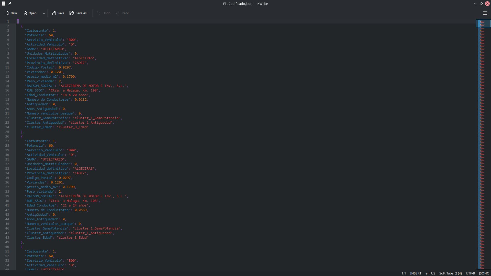
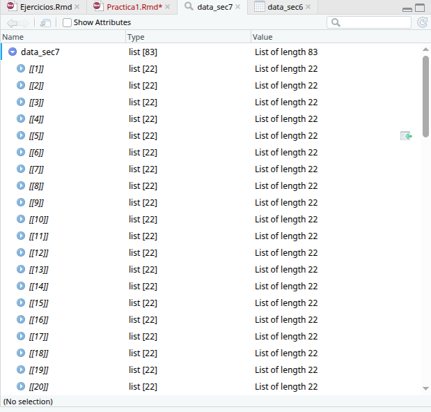
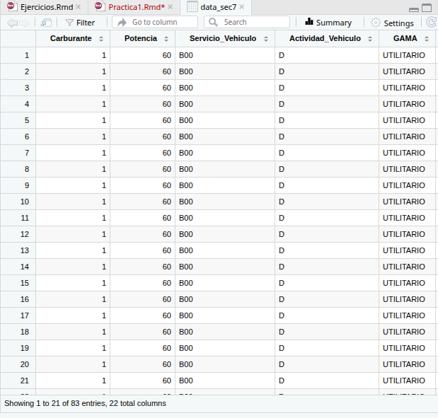
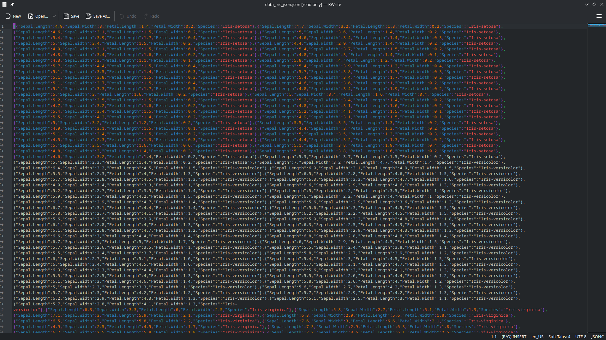
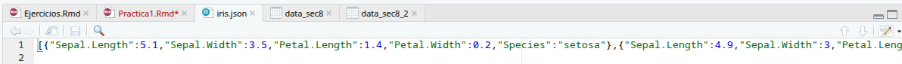
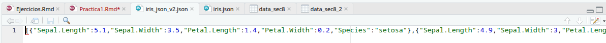
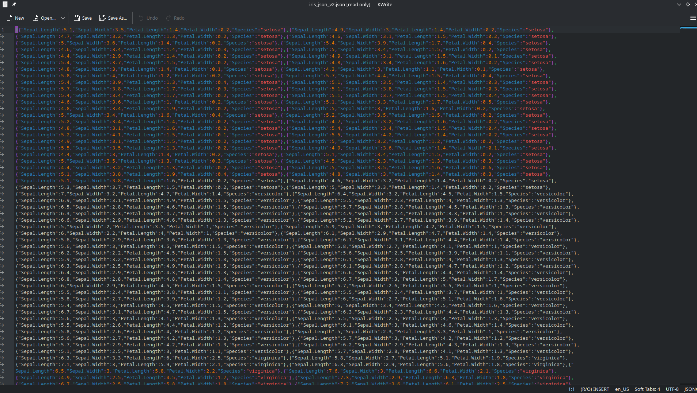

# 1. Introducción

Nada que hacer aquí, son instrucciones de cómo presentar la memoria.

# 2. Ejemplo: fichero
*DFP1_11122015 124700.csv*

## Importación del fichero

1.  Usar la herramienta de importación para previsualizar el resultado
    final. Compara las opciones *base* y *readr*.

El paquete base, a priori, reconoce que el separador son tabs. Por lo tanto importa los datos correctamente. En cambio, readr, como opción *default* solo reconoce las comas como separadores, por lo que importa los datos a un dataframe con una sola columna.

No obstante, esto se puede configurar en el asistente para que utilice los tabs como separador y obtener así exactamente la misma tabla.

A parte de eso, base sustituye los espacios por puntos, mientras que readr no. Aquí no hay espacios por lo que esto realmente no importa en este caso específico.

2.  Leer el fichero con `read.csv` y el parámetro
    `stringsAsFactors=F`.

```{r}
fname <- 'data/DFP1_11122015 124700.csv'
data <- read.csv(fname, stringsAsFactors = F, sep = "\t")
```

3.  Convertir fecha y hora con as.POSIXlt y as.hms (hms library).

```{r}
data$FECHA <- as.POSIXlt(data$FECHA, format = "%d/%m/%Y")

library(hms)
data$HORA <- as.hms(data$HORA)
```

4.  Almacenar con `save` en una carpeta con nombre results dentro de la carpeta data.

```{r}
savedir <- './data/results/'
filename <- 'seccion2.1_DFP1.RData'
if (!file.exists(savedir)) dir.create(savedir)
save(data, file=paste0(savedir, filename))
```

## Inspección de datos

Inspecciona los datos con str, head, tail y summary. Describid que informacion os proporciona cada uno de ellos.

```{r}
str(data)
```

`str` nos da una vista rápida y básica de los nombres de las columnas, la cantidad de filas y columnas, los tipos de cada columna y una overview rápida de sus primeros contenidos.

```{r}
head(data)
```

`data` nos muestra las primeras 6 filas.

```{r}
tail(data)
```

`tail` nos muestra las últimas 6 filas.

```{r}
summary(data)
```

`summary` nos muestra los estadísticos básicos para cada columna: mínimo, máximo, cuantiles, mediana y media.

# 3. Fichero *Transactions from a Bakery* (Kaggle)

## Importación del fichero

Una vez hemos descargado el fichero Bakery Sales Dataset podríamos leerlo con read.csv y transformar los datos a los tipos correctos.

Otra opción es usar la librería readr para especificar directamente el tipo de datos.

1.  Utiliza *Import Dataset* de RStudio, opción *readr*, para previsualizar el fichero y especificar los tipos de datos.


2.  Copia el código resultante y comprueba la lectura de datos.

```{r}
library(readr)
bakery_sales_revised <- read_csv("data/bakery/bakery_sales_revised.csv", 
                                 col_types = cols(date_time = col_datetime(format = "%m/%d/%Y %H:%M")))
View(bakery_sales_revised)
```

Por alguna razón, el formato en `data/bakery/bakery_sales_revised.csv` es `"%d/%m/%Y %H:%M"`, y, sin embargo, no funciona. Sólo funciona al poner `"%m/%d/%Y %H:%M"`.

3.  Guarda el data frame con `save` en la carpeta results.

```{r}
filename <- 'bakery_sales_revised.RData'
save(bakery_sales_revised, file=paste0(savedir,filename))
```

## Inspección de los datos

1.  Inspecciona los datos con `str`, `head`, `tail` y `summary`.

```{r}
str(bakery_sales_revised)
head(bakery_sales_revised)
tail(bakery_sales_revised)
summary(bakery_sales_revised)
```

# 4. Fichero SPSS *PsychBike.sav*

## Importación del fichero

Podemos leer ficheros de IBM SPSS mediante la librería `haven`.

1.  Leer el fichero con `read_sav`.

```{r}
#install.packages('haven')
library(haven)

filename <- "data/PsychBike.sav"
data_sec4 <- read_sav(filename)
```

2.  Inspección de los datos

```{r}
str(data_sec4)
head(data_sec4)
tail(data_sec4)
summary(data_sec4)
```

# 5. Fichero data *iris.zip*

Visualiza la pagina web de los datos [Iris del repostorio de UCI Machine Learning](https://archive.ics.uci.edu/dataset/53/iris), copia el link de descarga y guarda el archivo zip en la carpeta data.

## Descomprimir el fichero

1.  Utiliza la funcion `unzip` para descoprimirlo en la carpeta data.

```{r}
URL <- 'https://archive.ics.uci.edu/static/public/53/iris.zip'
pathfile <- './data/iris.zip'
download.file(url=URL, destfile=pathfile)

savedir <- './data/iris'
if (!file.exists(savedir)) dir.create(savedir)
unzip(pathfile, exdir=savedir)
```

# 6. Fichero data *iris.data*

## Importación del fichero

1.  Utiliza la funcion `read_table` para importar los datos.

```{r}
savedir <- './data/iris/'
filename <- 'iris.data'
data_sec6 <- read.table(paste0(savedir,filename), sep = ",")
```

2.  Cambia el nombre de las columnas por las que corresponda a la base datos (mirar la información en la página web).

```{r}
names(data_sec6) <- c('sepal_length', 'sepal_width', 'petal_width', 'petal_width', 'class')
data_sec6
```

3.  Guarda el data frame con `save` en la carpeta results.

```{r}
save(data_sec6, file='./data/results/iris.RData')
```

## Inspección de los datos

```{r}
str(data_sec6)
head(data_sec6)
tail(data_sec6)
summary(data_sec6)
```

# 7. Fichero JSON *FileCodificado.json*

## Importación del fichero

Los ficheros JSON (JavaScript Object Notation) son ficheros de texto que contienen datos (originalmente presentaciones de objetos JavaScript). Es un formato muy popular que se utiliza frecuentemente como alternativa a los ficheros XML, puesto que son más fáciles de leer e interpretar.

En R podemos importar ficheros JSON con la librería jsonlite. Las funciones más empleadas son:

- `read_json` y `write_json`: leen/escriben objetos R directamente de/en ficheros JSON.

- `toJSON`: obtiene una representación JSON de un objeto R.

- `fromJSON`: inversa de la anterior, convierte una representación JSON en un objeto R.

## Importar el fichero `FileCodificado.json`

1.  Abrir el fichero FileCodificado.json con un editor de texto (el de RStudio vale) para ver qué contiene. Comprobaremos que se puede leer e interepretar con facilidad.



2.  Importar el fichero a R con read_json. Observar la importancia del parámetro simplifyVector.

```{r}
library(jsonlite)
pathfile <- './data/FileCodificado.json'
data_sec7 <- read_json(pathfile, simplifyVector = T)
```

con `simplifyVector = T`, obtenemos algo muy poco humanamente legible:



Sin embargo, al activarlo `True`, obtenemos algo mucho más interpretable:



3.  Almacenar los resultados en `FileCodificado.RData` en la carpeta results.

```{r}
save(data_sec7, file='./data/results/FileCodificado.RData')
```

## Inspección de los datos

```{r}
str(data_sec7)
head(data_sec7)
tail(data_sec7)
summary(data_sec7)
```

# 8. Fichero JSON *iris_json.json*

## Importar el fichero `iris_json.json`

1.  Abrir el fichero iris_json.json con un editor de texto (el de RStudio vale) para ver qué contiene. Comprobaremos que se puede leer e interepretar con facilidad.



2.  Importar el fichero a R con read_json.

```{r}
filename <- ("./data/iris_json.json")
data_sec8 <- read_json(filename)
```

3.  Importa el fichero a R con fromJSON. ¿Que diferencia hay entre read_json y fromJSON?

```{r}
data_sec8_2 <- fromJSON(filename)
```

Por defecto, read_json() importa de forma poco interpretable, tal y como hemos visto en la sección anterior. En cambio, fromJSON importa perfectamente los datos. No obstante, si activamos `simplifyVector = T`, ambas funciones funcionan igual de bien.

4.  Almacenar los resultados en `iris_json.RData` en results.

```{r}
filename <- ("./data/results/iris.Rdata")
save(data_sec8_2, file=filename)
```

## Inspección de los datos

```{r}
str(data_sec8_2)
head(data_sec8_2)
tail(data_sec8_2)
summary(data_sec8_2)
```

## Exportar datos en formato JSON

1.  Lee los datos iris almacendos previamente en iris.Rdata y guardalos en json usando write_json. Abrir el fichero con RStudio y comprobar el resultado.

```{r}
filename <- "./data/results/iris.Rdata"
load(filename)
write_json(data_sec8_2, './data/results/iris.json')
```



2.  Como alternativa, obtener la representación JSON de los datos con toJSON y luego almacenarlos con write_file. Observar la diferencia de usar o no el parámetro pretty en toJSON.

```{r}
data_sec8_3 <- toJSON(data_sec8_2)
filename <- 'data/results/iris_json_v2.json'
write_file(data_sec8_3, filename)
```



Exactamente el mismo resultado! (RStudio muestra todo como si estuviera en la misma línea, pero mi lector KWrite lo muestra mejor) e.g.



# 9. Fichero ERCA.xlsx
